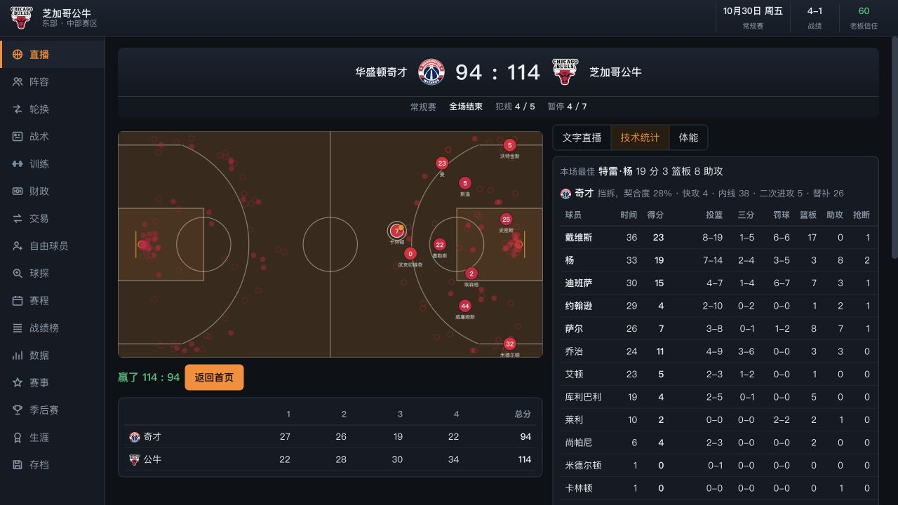

# 胜负逻辑调整与验收记录

日期：2026-10-20。本页记录本地源码与两个生成 HTML 的修改和验收；线上发布状态单独核验。

## 修改内容

1. 罚球球权：按最后一罚是否命中判定是否抢篮板；投篮犯规、加罚、全队犯满和故意犯规统一处理。罚球命中数、得分和原有事件字段保持原格式。
2. 赛前体能：状态除以 100，限制在 0.2–1；引擎不再将输入抬到 0.5。初始体能系数为 `0.8 + 0.2 × energy`，状态 20/50/80/100 对应 84%/90%/96%/100%。旧存档缺失状态时仍使用满体能。
3. 比分补偿：起点保持领先 3 分；每多 1 分从 0.3 减为 0.15 个百分点，单侧上限从 6 减为 3 个百分点。其余投篮基础参数保持不变。
4. 使用构建脚本同步 `index.html`、`篮球经理.html`，更新 service worker 缓存为 `bbm-v8-balance`。

## 自动化验证

- 新增规则回归：28 项通过，包括两队的一罚、两罚、三罚，最后一罚中/失，进攻篮板续攻，四类罚球入口，低体能传递，旧存档加载及比分补偿上下限。
- 原有功能回归：32 项通过。该脚本主动制造 QuotaExceeded 以测试失败提示，日志中的对应错误属于预期场景。
- 两个完整赛季：常规赛均完成 1230 场、无非法或平局比分、统计为有限数，季后赛结束并生成冠军和总决赛 MVP；赛季结束后保存、加载成功。
  - 种子 7：第 208 天结束，冠军球队索引 20，FMVP 球员 ID 351。
  - 种子 41：第 210 天结束，冠军球队索引 26，FMVP 球员 ID 454。
- 生成物检查：两个 HTML 字节相同；所有内联脚本通过 `node --check`；与修改前 HTML 比较，仅包含预期的引擎和体能转换变化，无其他 UI 或球员数据变更。

## 批量对照结果

修改前、修改后各 3480 场。30 队均衡主客场循环四轮，每队 232 场；没有跨场体能和伤病累积，因此此表用于观察规则和比分补偿，不代表完整生涯赛季表现。

| 指标 | 修改前 | 修改后 |
|---|---:|---:|
| 每队场均得分 | 115.99 | 114.83 |
| 估算回合数 | 101.11 | 100.15 |
| 每百回合得分 | 114.71 | 114.65 |
| 投篮命中率 | 47.5% | 47.4% |
| 三分命中率 | 37.0% | 36.8% |
| 场均罚球 | 21.47 | 21.22 |
| 主场胜率 | 55.6% | 54.7% |
| 平均绝对分差 | 10.86 | 13.00 |
| 分差至少30分占比 | 2.6% | 6.3% |
| 加时比例 | 5.3% | 3.9% |

**校准限制：加时比例由 5.26% 降到 3.91%，低于旧规范 5%–7% 的目标。这项保留为后续观察指标。其余脚本列出的 18 项指标都处于原目标范围。**

## 实力与体能对照

镜像公牛阵容、固定轮换、均衡体系、中立场，交替主客；场内伤病近似关闭。每个条件各 1200 场，种子 `12345+j*13`。属性提升实验包含各项具体属性，不等同于总评增加相同点数；体能实验为全队相同状态，不能直接推断单名球员的影响。

| 条件 | 被调整一方胜率 | 场均净胜分 |
|---|---:|---:|
| 全员各项属性 +0 | 51.8% | 0.55 |
| 全员各项属性 +5 | 78.1% | 11.69 |
| 全员各项属性 +10 | 94.3% | 22.51 |
| 全队初始状态 20，对手满状态 | 24.4% | -9.96 |
| 全队初始状态 50，对手满状态 | 35.9% | -5.38 |
| 全队初始状态 80，对手满状态 | 50.1% | 0.04 |
| 全队初始状态 100，对手满状态 | 51.8% | 0.55 |

总计 15360 场此类独立模拟（修改前/后联盟对照、三组属性实验、四组体能实验）；另有两次完整赛季。胜率为抽样值，小幅差异不作确定结论。

## 浏览器验收

- 使用 Codex 应用内浏览器，经 localhost HTTP 访问；初始选择球队页面确认该来源无篮球生涯存档，之后仅建立独立公牛测试进度。
- 从页面内联脚本确认实际加载了新版追分参数、最后一罚规则和体能转换，浏览器 error 日志为空。
- 更新缓存后测试进度保留；快速模拟一周完成四场；直播逐回合运行后结算为奇才 94–114 公牛。
- 刷新后保留 10月30日、4–1 战绩、化学反应 51 与相应伤病天数。
- 本次为桌面浏览器验收；未进行手机或真机验收。



## 复跑入口

```sh
node _tools/balance_20261020/regression.cjs
node _tools/fix_20261004/regression.js
node _tools/balance_20261020/season.cjs
node _tools/balance_20261020/simulate.cjs [修改前engine.js路径]
python3 _tools/build_html.py
```

详细证据：`regression-results.json`、`simulation-results.json`、`season-results.json`、`browser-results.json`、`build-verification.json`。修改前源码临时备份：`/tmp/bbm-before-20261020/`。
